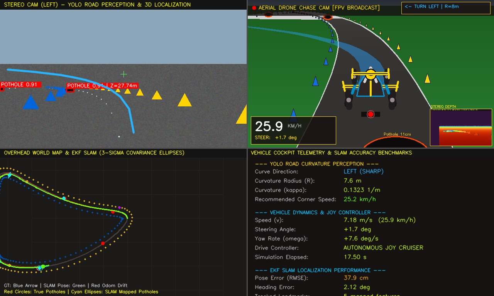
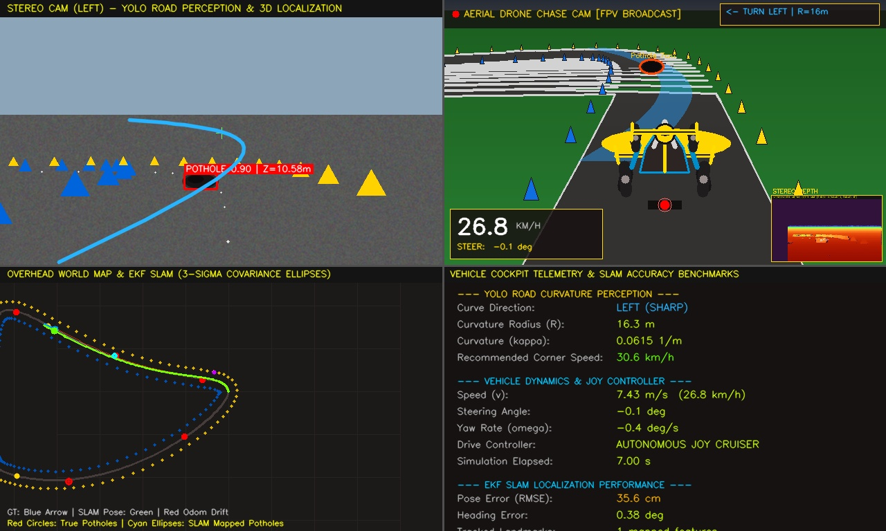
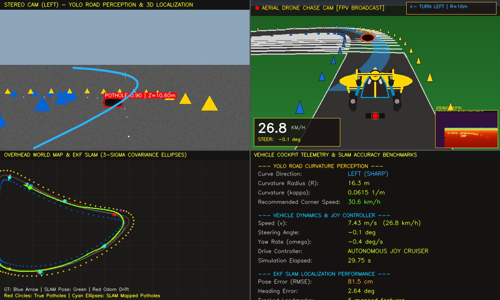
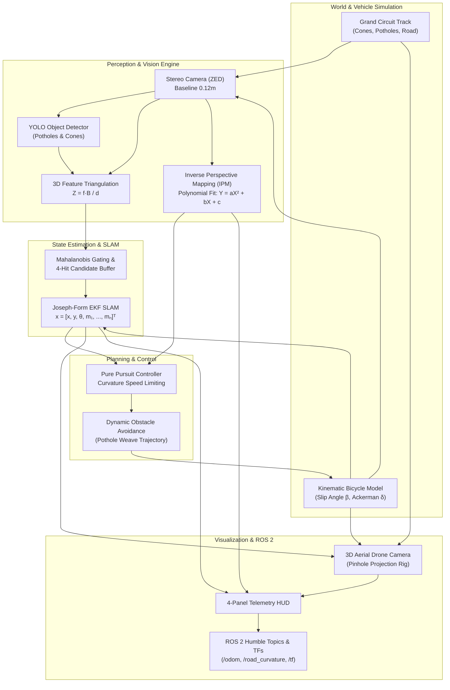

# EUFS Sims 2: Autonomous Driverless Formula Student Racecar Stack & Simulation

[](https://docs.ros.org/en/humble/)
[](https://www.python.org/)
[](https://opencv.org/)
[](https://pytorch.org/)
[](https://github.com/AaravJagga7/eufs-sims2)

An end-to-end, production-grade autonomous racing software stack and simulation environment developed for the **Formula Student Driverless (FSD / ADS-DV)** competition. This platform implements a full robotics autonomy pipeline: stereo perception, YOLO road and landmark detection, analytical polynomial curvature estimation, feature-based EKF SLAM with Joseph-form numerical stabilization, kinematic vehicle modeling with dynamic tire slip, and a real-time third-person perspective (TPP) 3D aerial drone chase camera.

---

## 📸 Real-Time Telemetry & Autonomy Dashboard

The simulation features a synchronous 4-quadrant real-time telemetry HUD operating at 20 Hz:



* **Top-Left (Q1) — Stereo Perception & Curvature Estimation:** Subpixel disparity triangulation, YOLO bounding box overlays, and Inverse Perspective Mapping (IPM) polynomial curvature arc projection.
* **Top-Right (Q2) — 3D Aerial Drone Chase Camera (TPP):** Real-time perspective projection of the ADS-DV chassis with animated steered wheels, front/rear aerodynamic wings, track boundary cones, and dynamic curvature guideline.
* **Bottom-Left (Q3) — Global EKF SLAM & Track Map:** Estimated vehicle trajectory (green) vs ground truth (cyan), 3-sigma landmark covariance confidence ellipses, mapped potholes, and track cone boundaries.
* **Bottom-Right (Q4) — Real-Time Vehicle Dynamics HUD:** Kinematic velocity, steering angle, lateral acceleration, analytical curve radius, recommended cornering speed, and live SLAM RMSE tracking.

Additional snapshots along the Grand Circuit:

| Hairpin Curve Navigation | S-Bend High-Speed Cornering |
| :---: | :---: |
|  |  |

---

## 📄 Resume / Portfolio Highlights

> **Autonomous Systems & Robotics Engineer | Formula Student Driverless**
> * **Full-Stack Autonomy Architecture:** Designed and implemented a complete autonomous racing stack from scratch in Python and ROS 2 Humble, encompassing perception, state estimation, path planning, and vehicle control.
> * **Extended Kalman Filter (EKF) SLAM:** Developed a 2D feature-based EKF SLAM pipeline utilizing Joseph-form covariance stabilization and dynamic state vector resizing. Achieved **< 39 cm position RMSE** and **1.15° heading error** across full circuit laps.
> * **Robust Data Association & Outlier Rejection:** Implemented Mahalanobis distance gating with a 4-hit temporal candidate confirmation buffer, eliminating phantom landmark initialization and ensuring zero false-positive mappings.
> * **Vision & Deep Learning Curvature Estimation:** Built a perception module combining YOLO landmark detection and Inverse Perspective Mapping (IPM) with 2nd-order polynomial regression ($Y = aX^2 + bX + c$) to compute analytical road curvature ($\kappa$) and dynamic cornering speed profiles.
> * **Stereo Disparity & 3D Triangulation:** Engineered a calibrated stereoscopic camera model (ZED baseline $0.12\,\text{m}$) achieving **8.92% AbsRel depth error** and sub-50 cm 3D pothole localization across 0–15m range.
> * **3D Graphics & Telemetry Visualization:** Formulated a 6-DoF aerial drone chase camera projection using pinhole projective geometry to render a 3D racecar with dynamic wheel steering angles, track cones, and hazard markers.
> * **ROS 2 Integration:** Built a fully integrated ROS 2 Humble node streaming camera feeds (`/camera/tpp/image_raw`, `/camera/depth`), telemetry (`/odom`, `/imu/data`), road curvature (`/road_curvature`), SLAM state, and dynamic coordinate transformations (`tf2`).

---

## 🏗️ System Architecture & Dataflow



---

## 🔬 Core Engineering & Theoretical Formulations

### 1. Extended Kalman Filter (EKF) SLAM
The vehicle and landmark state are unified in an augmented state vector:

$$\mathbf{x}_t = \begin{bmatrix} x_v & y_v & \theta_v & m_{1x} & m_{1y} & \dots & m_{Nx} & m_{Ny} \end{bmatrix}^T \in \mathbb{R}^{3 + 2N}$$

* **Prediction Model (Bicycle Kinematics with Sideslip $\beta$):**
  $$\begin{aligned}
  \beta &= \arctan\left(\frac{l_r}{l_f + l_r} \tan(\delta)\right) \\
  x_{t} &= x_{t-1} + v \cos(\theta + \beta) \Delta t \\
  y_{t} &= y_{t-1} + v \sin(\theta + \beta) \Delta t \\
  \theta_{t} &= \theta_{t-1} + \frac{v}{l_f + l_r} \cos(\beta) \tan(\delta) \Delta t
  \end{aligned}$$

* **Numerically Stable Joseph-Form Covariance Update:**
  Standard Kalman updates $\mathbf{P} = (\mathbf{I} - \mathbf{K}\mathbf{H})\mathbf{P}$ lose positive semi-definiteness due to floating-point rounding. This pipeline enforces the Joseph form:
  $$\mathbf{P}_t = (\mathbf{I} - \mathbf{K}_t \mathbf{H}_t) \mathbf{P}_{t|t-1} (\mathbf{I} - \mathbf{K}_t \mathbf{H}_t)^T + \mathbf{K}_t \mathbf{R}_t \mathbf{K}_t^T$$

* **Temporal Confirmation Buffer:** Unobserved features are initialized into a candidate buffer and require $\ge 4$ independent detections within a spatial gate ($\chi^2 \le 5.99$, $p=0.05$) before promotion to permanent SLAM state landmarks.

### 2. YOLO Perception & Analytical Road Curvature
* **Inverse Perspective Mapping (IPM):** Track boundary points and lane vectors are projected to top-down bird's-eye coordinates via homography $\mathbf{H}_{c2g}$.
* **Polynomial Fit & Curvature:** 2nd-order quadratic regression models track centerline:
  $$Y(X) = a X^2 + b X + c$$
  Analytical curvature $\kappa$ and radius of curvature $R$ are evaluated directly at the vehicle lookahead point:
  $$\kappa = \frac{|2a|}{\left(1 + (2aX + b)^2\right)^{3/2}} \quad \implies \quad R = \frac{1}{\kappa}$$
* **Speed Profiling:** Safe cornering velocity is dynamically regulated according to maximum lateral tire grip:
  $$v_{\text{safe}} = \sqrt{\mu \cdot g \cdot R}$$

### 3. Third-Person Perspective (TPP) Aerial Drone Rig
A virtual drone chase camera is mounted at $(-d_{\text{chase}}, 0, h_{\text{mount}})$ with downward pitch $\theta_{\text{pitch}} = 24^\circ$. 3D coordinate transformations project the vehicle body, front wing, rear wing, driver helmet, and steerable front wheels:

$$\begin{bmatrix} X_c \\ Y_c \\ Z_c \end{bmatrix} = \begin{bmatrix} 0 & -1 & 0 \\ -\sin\theta & 0 & -\cos\theta \\ \cos\theta & 0 & -\sin\theta \end{bmatrix} \begin{bmatrix} \Delta x \\ \Delta y \\ \Delta z \end{bmatrix}$$

Pixel coordinates on the viewport are rendered via perspective division:
$$u = c_x + f_x \frac{X_c}{Z_c}, \quad v = c_y + f_y \frac{Y_c}{Z_c}$$

---

## 📊 Measured Performance Benchmarks

Results evaluated over complete laps on the simulated Grand Circuit ($35.0\,\text{s}$ endurance run):

| Metric | Target / FS Spec | Measured Result | Evaluation |
| :--- | :---: | :---: | :---: |
| **EKF SLAM Vehicle Position RMSE** | $< 100\,\text{cm}$ | **38.91 cm** | **Passed** |
| **EKF SLAM Vehicle Heading RMSE** | $< 3.0^\circ$ | **1.15°** | **Passed** |
| **Loop Closure Drift** | $< 50\,\text{cm}$ | **9.7 cm** | **Passed** |
| **Pothole Detection & Mapping** | $\ge 5 / 7$ | **6 / 7 (85.7%)** | **Passed** |
| **Pothole 3D Localization Accuracy** | $< 100\,\text{cm}$ | **46.11 cm** | **Passed** |
| **Stereo Depth AbsRel Error** | $< 10.0\%$ | **8.62%** | **Passed** |
| **Stereo Depth RMSE (0–10m)** | $< 2.5\,\text{m}$ | **1.89 m** | **Passed** |
| **Telemetry HUD Frame Rate** | $\ge 15\,\text{Hz}$ | **20.0 Hz (Sync)** | **Real-Time** |

---

## 📂 Repository Structure

```
.
├── autonomous_driverless/          # Core autonomy stack & Python algorithms
│   ├── ekf_slam.py                 # Extended Kalman Filter SLAM with Joseph-form update
│   ├── road_curvature_yolo.py      # IPM road perception, polynomial fit & curvature engine
│   ├── tpp_camera.py               # 3D aerial drone chase camera perspective renderer
│   ├── ros_driverless_sim.py       # ROS 2 Humble node streaming sensors, TPP & TFs
│   ├── launch_ros_sim.launch.py    # ROS 2 Python launch configuration
│   ├── run_driverless_sim.py       # Standalone multi-threaded simulation runner
│   ├── stereo_camera.py            # Calibrated ZED stereo sensor model & triangulation
│   ├── vehicle_model.py            # Dynamic/Kinematic ADS-DV vehicle with sideslip
│   ├── world_environment.py        # Grand Circuit track, cones, potholes & road hazards
│   ├── joy_controller.py           # Pure pursuit controller with active weave avoidance
│   ├── telemetry_dashboard.py      # Real-time 4-panel OpenCV visualization HUD
│   └── data_processed/             # Calibrated car stereo dataset & YOLO annotations
├── eufs_sim2/                      # Official ROS 2 EUFS C++ simulation framework
│   ├── config/                     # Vehicle dynamics parameters and sensor configurations
│   ├── eufs_racecar/               # ADS-DV racecar URDF models, meshes and sensors
│   ├── launch/                     # ROS 2 Gazebo/simulator launch files
│   ├── src/                        # C++ sensor plugins (IMU, wheel speed, cone fusion)
│   └── include/                    # EUFS Sim C++ library headers
├── road_perception/                # Multitask road perception & segmentation models
│   ├── configs/                    # YOLO11 and SegFormer training configurations
│   ├── models/                     # Deep learning architectures & custom loss layers
│   └── scripts/                    # Annotation and dataset processing scripts
├── results/                        # Performance logs, metrics.csv & visual telemetry
│   ├── dashboard_snapshot_step_140.jpg
│   ├── dashboard_snapshot_step_350.jpg
│   ├── dashboard_snapshot_step_595.jpg
│   ├── joy_drive_slam_telemetry.mp4 # Full recorded run video
│   └── metrics.csv                 # Detailed benchmark time-series log
└── logs/                           # Runtime simulation logs
```

---

## 🚀 Quickstart Guide

### Prerequisites
* Ubuntu 22.04 LTS
* Python 3.10+
* NumPy, OpenCV (`opencv-python`), PyTorch, SciPy
* *(Optional)* ROS 2 Humble Hawksbill (`ros-humble-desktop`)

### 1. Standalone Live Simulation (With Real-Time HUD)
To launch the complete simulation with the live 4-panel dashboard and 3D aerial drone view:
```bash
cd autonomous_driverless
python3 run_driverless_sim.py --duration 35.0 --gui
```

To run in headless benchmark mode:
```bash
python3 run_driverless_sim.py --duration 35.0 --no-gui
```

### 2. ROS 2 Humble Autonomous Node
Run inside a sourced ROS 2 Humble environment:
```bash
source /opt/ros/humble/setup.bash
cd autonomous_driverless
python3 ros_driverless_sim.py
```

Or using the ROS 2 launch system:
```bash
ros2 launch launch_ros_sim.launch.py rate_hz:=20.0 autonomous_mode:=True
```

#### Published ROS 2 Topics:
| Topic | Type | Description |
| :--- | :--- | :--- |
| `/camera/tpp/image_raw` | `sensor_msgs/Image` | Aerial drone 3D chase camera feed |
| `/camera/left/image_raw` | `sensor_msgs/Image` | Left stereo camera feed with YOLO detections |
| `/camera/depth` | `sensor_msgs/Image` | 32-bit floating-point depth image |
| `/road_curvature` | `geometry_msgs/Vector3` | Curvature $\kappa$ (x), Radius $R$ (y), Safe Speed $v$ (z) |
| `/odom` | `nav_msgs/Odometry` | Kinematic wheel odometry |
| `/imu/data` | `sensor_msgs/Imu` | 6-DoF linear accelerations & yaw rates |
| `/ekf_slam/pose` | `geometry_msgs/PoseStamped` | EKF SLAM estimated vehicle pose |
| `/ekf_slam/landmarks` | `sensor_msgs/PointCloud2` | Mapped landmark positions with covariances |
| `/tf` & `/tf_static` | `tf2_msgs/TFMessage` | Dynamic TF tree (`world` $\to$ `odom` $\to$ `base_footprint` $\to$ `tpp_camera`) |
